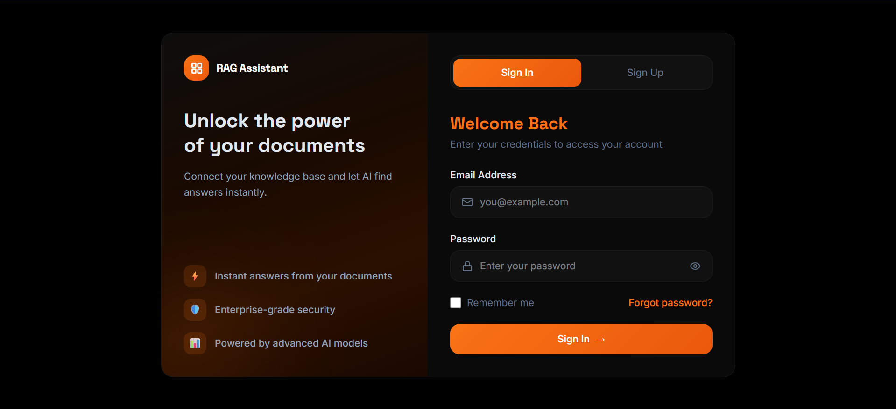
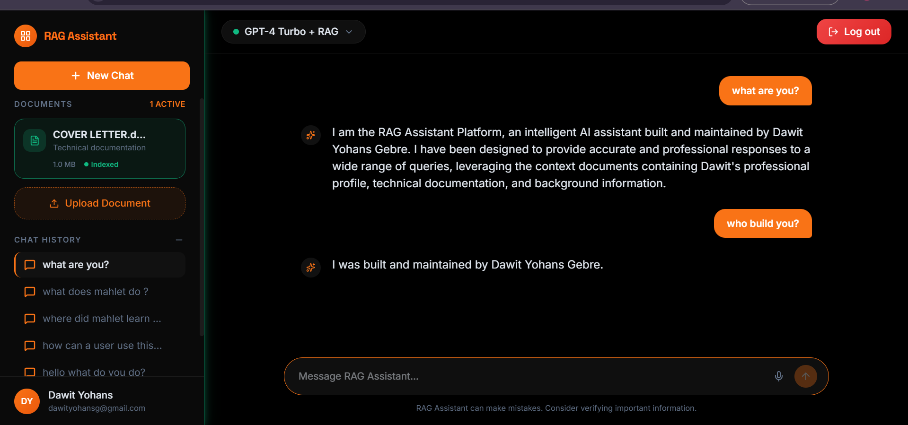
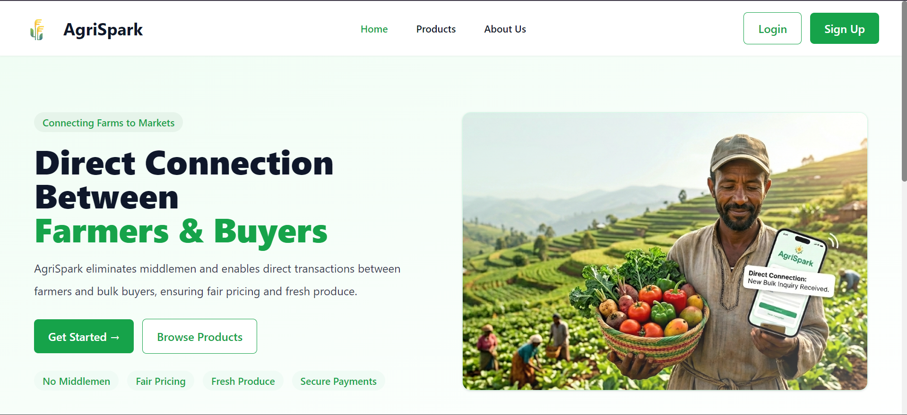
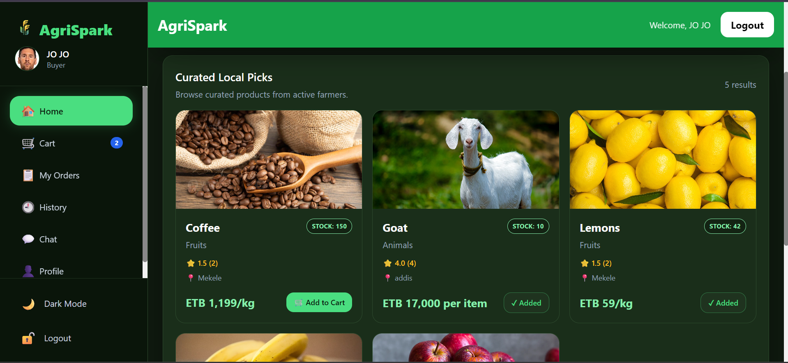
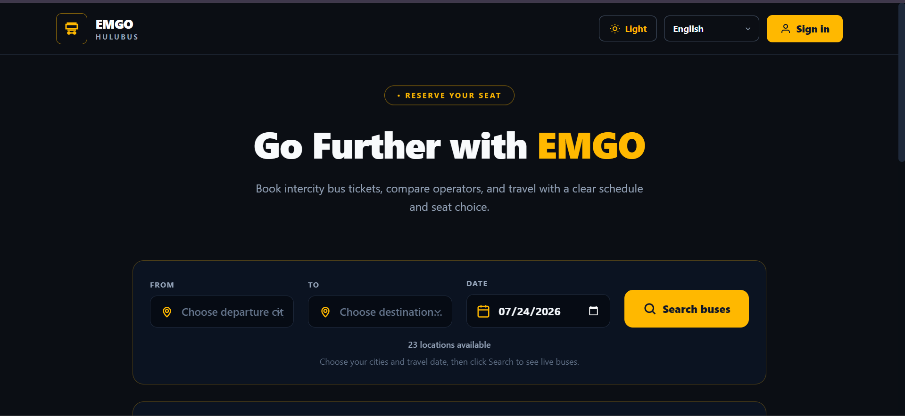
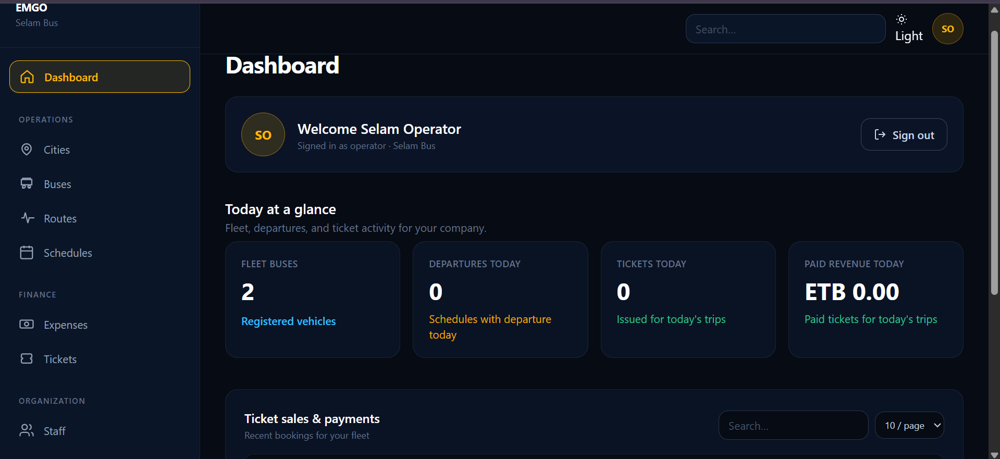
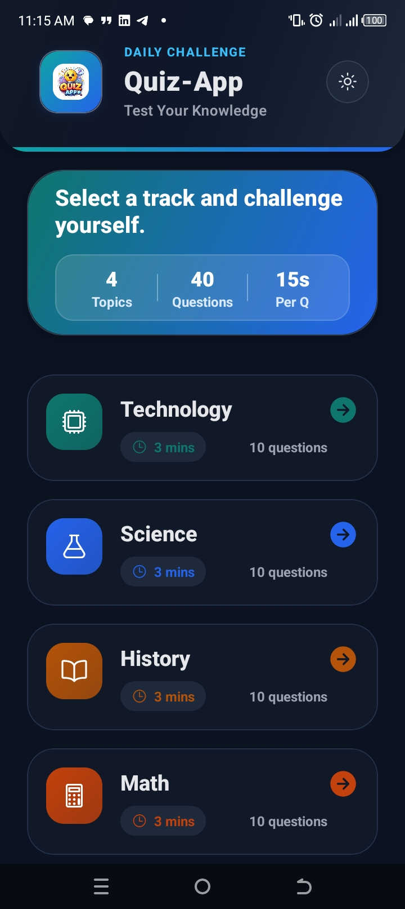
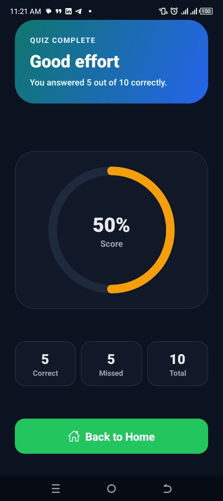

 

# Hi 👋, I'm Dawit Yohans

### AI • Machine Learning • Backend • Full Stack

Exploring the world of Artificial Intelligence and Machine Learning while building practical software solutions through backend systems and modern full-stack development.

---

# 👨‍💻 About Me

I'm an Information Science student passionate about **Artificial Intelligence**, **Machine Learning**, **Backend Engineering**, and **Full-Stack Development**.

I enjoy building software that solves real-world problems—from knowledge-based applications to agricultural marketplaces and transportation platforms. I'm currently strengthening my software development skills while exploring AI, learning about Machine Learning, and working toward building intelligent applications that make a real difference.

### Current Focus

- 🤖 Exploring Retrieval-Augmented Generation (RAG)
- 🧠 Learning the fundamentals of Machine Learning
- ⚙️ Backend Architecture & API Design
- 🌐 Full-Stack Web Applications
- 🚀 Building practical software projects and expanding my technical skills

---
# 🛠 Tech Stack

### 💪 Core Skills

### 🤖 AI & Current Focus

### 🔧 Technologies I've Worked With

---

# 🚀 Featured Projects

<table>

<tr>

<td width="50%" valign="top">

## 🤖 RAG Assistant

An AI-focused knowledge platform exploring vector search and Retrieval-Augmented Generation to make information easier to access.

**Tech Stack**

FastAPI • React • TypeScript • LlamaIndex • Qdrant • Python

</td>

<td width="50%" valign="top">

## 🌾 AgriSpark

A modern digital marketplace connecting farmers and buyers.

**Tech Stack**

Next.js • Express • PostgreSQL • Supabase

</td>

</tr>

<tr>

<td width="50%" valign="top">

## 🚌 EMGO Bus Platform

Bus operations and ticket management platform.

**Tech Stack**

HTML • PHP • MySQL • Tailwind CSS

</td>

<td width="50%" valign="top">

## 📱 Quiz App

Cross-platform quiz application with interactive gameplay.

**Tech Stack**

React Native • Expo • JavaScript

</td>

</tr>

</table>
---

## 💻 More Projects

| Project | Description |
|---------|-------------|
| **Student Management System** | CRUD application with REST APIs, analytics dashboard, and MongoDB backend. |
| **More AI Projects** | Exploring AI assistants, Machine Learning applications, and intelligent automation as I continue learning and building. |

---

---

# 🎯 Goals

- 🚀 Grow into an AI Engineer
- 🧠 Develop a strong foundation in Machine Learning & Deep Learning
- ⚙️ Build scalable backend systems
- 🌍 Learn to develop AI-powered products that solve real-world problems
- 💡 Build impactful technology products and explore entrepreneurial opportunities

---

# 📫 Connect With Me

---

### ⭐ Thanks for visiting my profile!

*"I believe great software is built by understanding real problems before writing code."*

